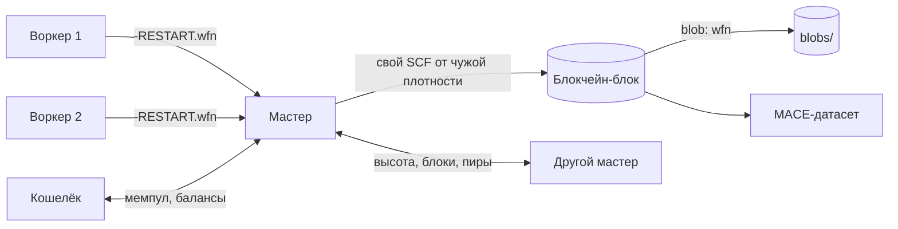

# CP2K + MACE — распределённые DFT-расчёты

Молекулы и кластеры произвольного состава (Cu, Al₂O₃, NaCl, …) считаются в CP2K на сети машин: **мастер** раздаёт задания,
**воркеры** считают, мастер **независимо проверяет** каждый результат, принятые данные
складываются в блокчейн-цепочку с UTXO-экономикой, а из них обучается MACE-модель.

📚 Документы: **[Whitepaper — блокчейн и проверка](docs/WHITEPAPER.md)** ·
[Измерения и производительность](docs/MEASUREMENTS.md) ·
[Публикация (Docker, GitHub)](docs/PUBLISHING.md)

---

## Оглавление

1. [Быстрый старт (параметры по умолчанию)](#быстрый-старт-параметры-по-умолчанию)
2. [Веб-панель](#веб-панель)
3. [Что происходит внутри](#что-происходит-внутри)
4. [Справочник параметров](#справочник-параметров)
   - [run.sh](#runsh) · [main.py](#мастер-mainpy) · [worker.py](#воркер-workerpy)
   - [src/config.json](#srcconfigjson) · [Переменные окружения](#переменные-окружения)
   - [master-cli.py](#master-clipy) · [wallet.py](#walletpy-и-webwalletpy)
   - [HTTP API мастера](#http-api-мастера) · [Порты и адреса](#порты-и-адреса)
5. [Структура проекта](#структура-проекта)
6. [Сценарии запуска](#сценарии-запуска)
7. [MACE-пайплайн](#mace-пайплайн)
8. [Результаты, тесты, диагностика](#результаты-тесты-диагностика)
9. [Устранение неполадок](#устранение-неполадок)

---

## Быстрый старт (параметры по умолчанию)

**Что нужно:** Linux или Windows + WSL2, Docker, `git`, ~40 ГБ диска
(образ ~13 ГБ CPU / ~21 ГБ GPU плюс данные расчётов).

- Windows: WSL2 — <https://learn.microsoft.com/windows/wsl/install>,
  Docker Desktop — <https://docs.docker.com/desktop/setup/install/windows-install/>
  (после установки включить **Settings → Resources → WSL Integration** для Ubuntu).
- Linux: Docker ставится автоматически скриптом `run.sh` (нужны `sudo` и интернет);
  вручную — <https://docs.docker.com/engine/install/ubuntu/>.

```bash
# 1. Код
git clone https://github.com/konstantinkorzov/cp2k-mace-project.git
cd cp2k-mace-project
chmod +x run.sh

# 2. Контейнер (скачает образ, поднимет мастер-контейнер в фоне)
./run.sh --cpu -d

# 3. Веб-панель внутри контейнера
#    (если node_modules ещё нет — контейнер стартовал без интернета — добавьте `npm install &&`)
docker exec -d cp2k-mace-cpu bash -c "cd /workspace && node src/webserver/index.js"
```

Откройте <https://127.0.0.1:8443> (сертификат самоподписанный: «Дополнительно → Перейти»)
и нажмите:

1. вкладка **Мастер** → «Запустить мастера» (порт и папка — «авто», пароль `master`);
2. вкладка **Воркер** → «Запустить воркера» (пароль `worker`).

Всё. Первый воркер возьмёт задачу, посчитает Cu₂ и отправит мастеру.

**Проверка, что окружение в порядке** (внутри контейнера):

```bash
docker exec -it cp2k-mace-cpu bash
python3 test/check_project.py      # ожидаем FAIL=0
```

<details>
<summary>Запуск без веб-панели (чистый CLI)</summary>

```bash
docker exec -it cp2k-mace-cpu bash

# мастер (в первом терминале)
python3 src/main.py --port 8000 --password master

# воркер (во втором терминале)
docker exec -it cp2k-mace-cpu python3 src/worker.py \
    --name worker1 --password worker --master http://127.0.0.1:8000
```
</details>

---

## Веб-панель

Одна страница, пять вкладок; всё делается мышью, без знания Linux.

| Вкладка | Что делает |
|---|---|
| **Мастер** | Запуск/остановка; порт — «авто» (свободный с 8000) или явно; каталог результатов выбирает код (`results`, затем `results-<порт>`); кошелёк выбирается по имени + пароль (создаётся на вкладке «Кошелёк»); очередь, высота цепочки, пиры (добавить/удалить), «Настройки» (`src/config.json`). |
| **Воркер** | Запуск/остановка; имя — ярлык процесса, отдельно выбираются кошелёк и пароль; список мастеров галочками (панель + пиры); чекбокс «подробный лог CP2K» (только для этого запуска); живой лог SCF и лог CP2K. |
| **MACE** | Запуск `mace_pipeline/run_mace.py` и его лог. |
| **Кошелёк** | Кошелёк — самостоятельная сущность, роли у него нет (мастер и воркер просто пользуются им). **Ничего не создаётся само:** по умолчанию список пуст, кошелёк появляется по кнопке «Создать» (имя + пароль). Имя — идентификатор, пароль — ключ; **пароль может быть общим у нескольких кошельков**. **«Система (элемент)»** — отдельная цепочка, как отдельный металл: у Cu и Fe свои монеты, свой UTXO и своя высота; монеты одной цепочки в другой не тратятся. Детали tx по клику, перевод **всем известным мастерам**, **«＋ адрес»**. |

Панель слушает **HTTPS :8443** и **HTTP :8080** (`WEBUI_PORT`), сертификат создаётся
при первом запуске. Кошельков изначально нет: создайте нужный на вкладке «Кошелёк»
(или `python3 src/wallet.py --create NAME`) и выберите его при запуске мастера/воркера.
Без кошелька мастер и воркер не стартуют — сообщение об этом видно в логе.

**Вход в панель обязателен.** Пароль администратора хранится scrypt-хэшем в
`results/webui.db` (не в открытом виде). При первом запуске он генерируется и
пишется в `results/webui_admin_password.txt` (права 600) и в лог панели;
задать свой можно через `WEBUI_ADMIN_PASSWORD` до первого старта. Смена пароля —
страница `/password` (ссылка в шапке), после смены все сессии инвалидируются.
Сессия — HttpOnly + SameSite=Strict cookie на 12 часов; перебор ограничен
5 попытками в минуту с одного IP. Без входа API отвечает `401`, страницы
редиректят на `/login`.

---

## Что происходит внутри



Коротко: геометрию задания строит **мастер** — по `seed` и, если задан, шаблону
`template_xyz` — и выдаёт воркеру готовые координаты. Воркер считает ровно эту
структуру до сходимости, но присылает не числа, а файл плотности (`-RESTART.wfn`).
Мастер сначала **дёшево сверяет геометрию с выданной** (без DFT), затем стартует
свой CP2K от этой плотности и требует, чтобы SCF сошёлся за 3 шага — только тогда
состояние считается стационарным, а E/силы/gap/диполь берутся из прогона мастера.
Подробно: [whitepaper](docs/WHITEPAPER.md).

---

## Справочник параметров

Всё, что можно задать: аргументы запуска, `config.json`, переменные окружения, CLI и API.
Если меняете только элемент и число задач — хватит `config.json` или панели.

### run.sh

| Флаг | Смысл |
|---|---|
| `--cpu` / `--gpu` | какой образ запускать (по умолчанию CPU) |
| `-d`, `--detach` | в фоне (иначе интерактивная оболочка) |
| `-w`, `--worker` | сразу запустить `src/worker.py` внутри контейнера |
| `-n`, `--name NAME` | имя контейнера: `cp2k-mace-<cpu\|gpu>-NAME` (по умолчанию `cp2k-mace-cpu`) |
| `--port 8443` | порт хоста для веб-панели |
| `--port2 8000` | порт хоста для API мастера |
| `--master-host HOST` | адрес мастера для воркера (по умолчанию `host.docker.internal`) |
| `--no-pull` | не тянуть образ перед запуском |
| `--prune` | удалить «висячие» образы после старта |

### Мастер: main.py

```bash
python3 src/main.py --port 8000 --wallet master --password root \
    --peer http://127.0.0.1:8001 --results-dir /workspace/results2
```

| Флаг / env | По умолчанию | Смысл |
|---|---|---|
| `--port` | `port` из `config.json`, иначе 8000 | порт HTTP API |
| `--wallet` / `MASTER_WALLET` | — | имя кошелька мастера (обязательно; создаётся явно) |
| `--password` / `MASTER_PASSWORD` | запрос в консоли | пароль этого кошелька |
| `--peer URL` (можно несколько) / `MASTER_PEERS` | пусто | другие мастера для синхронизации |
| `--results-dir` / `MASTER_RESULTS_DIR` | `results` | каталог цепочки, кошельков и логов |
| `MASTER_ADMIN_TOKEN` | — | **устарел:** админ-API теперь только с localhost |

### Воркер: worker.py

```bash
python3 src/worker.py --name worker1 --wallet worker1 --password root \
    --master http://127.0.0.1:8000 --master http://127.0.0.1:8001
```

| Флаг / env | По умолчанию | Смысл |
|---|---|---|
| `--name` | генерируется | ярлык процесса для логов и панели |
| `--wallet` / `WORKER_WALLET` | — | имя кошелька воркера (обязательно) |
| `--password` / `WORKER_PASSWORD` | запрос в консоли | пароль этого кошелька |
| `--master URL` (можно несколько) / `WORKER_MASTERS` | `http://<server>:<port>` | мастера; первый — основной |
| `--server` / `MASTER_HOST`, `--port` / `MASTER_PORT` | `host.docker.internal`, `8000` | адрес основного мастера, если не задан `--master` |
| `--verbose` / `--no-verbose` | как передал мастер | печатать шаги SCF для этого запуска воркера |

Воркер **не слушает порт**: он клиент. Раз в минуту он спрашивает у мастеров адреса
других мастеров (резерв на случай занятости основного).

**Heartbeat и возврат задач.** Воркер раз в 30 с шлёт `GET /heartbeat` — в том числе
пока идёт расчёт CP2K. Мастер считает воркера пропавшим, если тот молчит дольше
`WORKER_LEASE_SEC = 180` с, и сразу возвращает его задачу в очередь (раньше задача
висела до `task_timeout_sec`, т.е. сутки). Через 30 минут молчания запись о воркере
удаляется совсем. Если мастер перезапустили, воркер получает `400` от `/get-task`
и регистрируется заново автоматически.

**Регистрация воркера с доказательством ключа.** Мастер выдаёт одноразовый
nonce (`GET /register-challenge`), воркер подписывает `cp2k-mace-register:<nonce>`
своим ключом и присылает подпись. Только такая регистрация переиспользует
`worker_id` и снимает текущую задачу; неподписанная получает отдельную сессию
и чужую не трогает (иначе адрес можно было бы «занять» и валить задачи).

**Задания и seed.** `struct_id` содержит тег запуска мастера (`n2_t00000_<tag>`),
поэтому после перезапуска не появляются два блока с одинаковым идентификатором
задания. Seed геометрии теперь не «время запуска», а
`H(prev_id ‖ nonce)`: он однозначно определяется головой цепочки и попадает в
блок (`nonce`, `prev_id`), поэтому кадр воспроизводим, а подмена головы ломает
ранее выданные задания (мастер отвечает `stale head` и возвращает задачу).
Очередь пересобирается с избытком: лишние задания — буфер на случай отвала
воркеров, при смене размера они снимаются.

**Кто строит геометрию и когда она проверяется.** Мастер строит координаты и
сорт атомов сам и кладёт их в задание. Воркер считает ровно выданное.

- **Шаблон задан** (`template_xyz`): геометрия строится вокруг шаблона, и мастер
  сверяет присланное с выданным (допуск 1e-6 Å, без CP2K) — подмена ловится
  до запуска DFT. В блоке `geometry_policy: template`, `geometry_verified: true`.
- **Шаблона нет**: мастер выдаёт случайные 2D/3D кластеры (чередование
  `DIM_CYCLE`), но присланную геометрию **не сверяет** — приёмка как раньше:
  состав, `min_dist` и последние шаги DFT от `-RESTART.wfn`. В блоке
  `geometry_policy: random`, `geometry_verified: false`.
- **ready-путь** (результат принял мастер, который задание не выдавал):
  `geometry_policy: worker` — эталона у него нет.

**`atom_diameter` — параметр генерации, не консенсуса.** Мастер сам выбирает
диаметр (и может менять через админ-API): от него зависит, какие структуры он
**строит**. Приёмка же проверяет только физический минимум — 0.5 Å между
атомами (`MIN_ATOM_DISTANCE_ANG`). Поэтому два мастера с разными диаметрами
принимают одни и те же блоки и не расходятся; диаметр пишется в `dft.json`
для воспроизведения выборки.

**Деньги — только целые.** Единица = 1 монета, дробей нет вообще (float в
консенсусе даёт расхождения при суммировании и обходит проверки). Константы
протокола в `src/chain.py`: `COINBASE_VALUE = 50 000 000`, `REWARD_VALUE =
25 000 000`, `TX_FEE = 100 000`. Переводы — только целыми суммами; `0` и
отрицательные отклоняются, суммы проверяются как `int` на входе mempool, в
блоке и при полной проверке цепочки. Смена единиц = новый генезис (старые блоки
с float-суммами несовместимы).

**Заголовок блока — строгая схема (v2).** `header.json` содержит ровно 19
полей (`version, seq, element, n_atoms, dim, atom_diameter, prev_id,
created_at, state_sha256, state_path, cp2k_version, cp2k_build, cp2k_params,
tx_root, nonce, dft_sha256, geom_version, template, block_id`) с
фиксированными типами; лишнее или отсутствующее поле = блок не наш.
`block_id` — канонический хэш заголовка; `prev_id` — `block_id` предыдущего
блока (не хэш zip). Проверяется в `validate_header` (один блок, цепочка,
приём от пира).

**Работа привязана к цепочке (v2).** Геометрия блока N считается из
`seed = H(prev_id(N-1) ‖ nonce)`, а `block_id` включает `tx_root`
(меркл-корень транзакций), `state_sha256` (wfn) и `dft_sha256`. Поэтому:

- правка любой транзакции или числа в блоке N меняет `block_id(N)`;
- у блока N+1 меняется `prev_id` → по правилам протокола обязана измениться
  геометрия → старый `-RESTART.wfn` перестаёт соответствовать ей → нужен
  новый прогон DFT;
- переписать K блоков = **K прогонов DFT**, ровно как намайнить их заново.
  Подпись мастера этого не отменяет — она только атрибуция.

Это биткоиновая модель «переписать K блоков = K работ», но работа полезная
(кадры датасета), а не хэши. Самый свежий блок не защищён работой потомка
(0 подтверждений) — как и в Bitcoin; защита растёт с каждой высотой.

**Мемпул — как в Bitcoin.** Не больше `MEMPOOL_MAX_TX = 10 000` транзакций.
Когда мемпул полон, вытесняется самая дешёвая tx; новая принимается, только
если её комиссия выше минимальной в мемпуле. Конфликт (тот же вход) заменяется
только транзакцией с большей комиссией, чем у конфликтующих. В блок попадают
до `MAX_TXS_PER_BLOCK = 2000` переводов **по убыванию комиссии**, остальные
ждут следующего блока. Запись на диск — с дебаунсом 2 с (раньше файл
переписывался на каждый submit — O(n²) по диску).

**Лимит тела запроса.** Тело `POST` ограничено `1.4 × restart_max_mb + 2 МБ`
(base64 от максимально допустимого wfn) — больше не нужно, такой wfn мастер
всё равно отклонит; превышение → `413` до разбора JSON.

**Rate limit мастера.** Выдача задачи воркеру и приём результата — не чаще
раза в 5 секунд на воркера (`RATE_LIMIT_SEC`), иначе `429` с `Retry-After`.
Честный воркер этого не замечает: задача считается минутами.

**Сборка CP2K (консенсус).** Базовый образ пинится по digest —
`cp2k/cp2k:2024.3_mpich_generic_psmp@sha256:…`, а `Dockerfile` выставляет
`CP2K_BUILD`, который уезжает в `header.json` каждого блока (`cp2k_build`).
Мастер при старте сверяет свою сборку со списком сети (`CP2K_BUILD_EXPECTED`
в `src/cp2k_runner.py`): идентифицированная, но чужая сборка → отказ стартовать
(код 4); если `CP2K_BUILD` не задан (старый образ или запуск мимо образа) —
предупреждение, в блоке будет `build не указан`. Воркер проверяет то же самое
до регистрации, чтобы не тратить часы на состояние, которое мастер отбросит.
Смена базового образа = новая версия протокола (другая арифметика/формат лога).

### src/config.json

Один файл на мастер и воркера, формат `{"ключ": {"value": ..., "help": "..."}}`.

| Ключ | Смысл |
|---|---|
| `system` | что считаем: `{"name": "Cu", "composition": {"Cu": 1}, "atom_diameter": 2.0}` — имя системы (каталог `results/<name>`, поле в header), формульная единица и диаметр атома (от него `min_dist = diameter`, `max_dist = 2·diameter`) |
| `template_xyz` | необязательный путь к XYZ с образцовой геометрией: по нему геометрию строит **мастер** и выдаёт воркеру; близость проверяется сравнением с выданной (см. ниже) |
| `charge` / `multiplicity` | заряд системы и мультиплетность (`multiplicity: 0` — по чётности числа электронов, т.е. 1 или 2); фактическое значение пишется в `dft.json` блока — у одного и того же элемента оно зависит от `n` |
| `port` | порт мастера, если не передан `--port` (панель берёт его для «авто») |
| `peers` | список URL других мастеров |
| `verbose_cp2k` | печатать шаги SCF в лог (воркер может переопределить флагом `--verbose/--no-verbose` или чекбоксом при запуске) |
| `restart_max_mb` | лимит размера принятого `-RESTART.wfn`, МБ (для 55+ атомов — 512) |
| `cp2k_timeout_sec` | таймаут одного прогона CP2K, секунды (по умолчанию 1 ч; для димера хватает, для десятков атомов увеличьте) |
| `task_timeout_sec` | жёсткий предел удержания задачи (2 ч) — предохранитель; обычно задача возвращается через 3 минуты после пропажи heartbeat |
| `coinbase_confirmations` | через сколько блоков доступны новые монеты (настройка кошелька: `wallet.py --set-confirmations N`) |

> ⚠️ **Чего в config.json нет и не должно быть.** Расписание размеров
> (`start_atoms`, `base_blocks`, `exponent`, `max_atoms`) и чередование
> размерностей — **константы протокола** в `src/main.py` (`ATOM_SCHEDULE`,
> `DIM_CYCLE`). Если два мастера задают их по-разному, они начнут минтить блоки
> разных размеров на одной высоте — это неконтролируемый форк. Поменять правило
> = выпустить новую версию протокола и поднять сеть с новым генезисом.

### Шаблон геометрии (`template_xyz`)

По умолчанию мастер строит случайный кластер по правилу «у каждого атома есть
сосед в `[min_dist, max_dist]`». Если известна целевая структура (например,
релаксированная наночастица Cu₅₅), укажите путь к XYZ:

```json
"template_xyz": { "value": "data/Cu55.xyz", "help": "..." }
```

Мастер читает файл при старте (один или несколько кадров подряд) и проверяет,
что элементы входят в `system.composition`, а минимальное расстояние не меньше
`0.9·atom_diameter` (иначе не стартует). Дальше на **каждое задание** мастер:

1. подгоняет число атомов под `n` этапа: лишние отрезает (компактный фрагмент
   вокруг случайного атома), недостающие доращивает на поверхности;
2. смещает атомы гауссовым шумом (σ ≈ 0.08·`min_dist`), расталкивает слипшиеся
   пары, подтягивает оторванные и случайно поворачивает кластер;
3. кладёт готовые координаты в задание и хранит эталон у себя.

Воркер только считает выданное. **Если шаблон задан**, он не может подменить
структуру: присланная геометрия (и сорт/порядок атомов) сверяется с выданной
**до** запуска CP2K, и результат с чужими координатами отклоняется.
Если шаблона нет — сверки нет: задание обещает лишь «валидный кластер из n атомов»,
и мастер принимает любую такую структуру, а E/силы считает для присланной.

**Система — любая, а не только Cu.** Элементы берутся из `PSEUDOPOTENTIALS`
(`src/cp2k_runner.py`, H–Kr и часть тяжёлых), базис — `DZVP-MOLOPT-SR-GTH`:

```json
"system": { "value": { "name": "Al2O3", "composition": { "Al": 2, "O": 3 }, "atom_diameter": 1.8 } }
"system": { "value": { "name": "NaCl",  "composition": { "Na": 1, "Cl": 1 }, "atom_diameter": 2.4 } }
"system": { "value": { "name": "Cu",    "composition": { "Cu": 1 }, "atom_diameter": 2.0 } }
```

Имя системы — это каталог (`results/Al2O3/`), цепочка и датасет; разные системы
можно считать параллельно на разных мастерах. Размер всегда кратен формуле:
Al₂O₃ — 5, 10, 15… атомов; Cu — 2, 3, 4…

**Расписание размеров (константы протокола).** Этап `s` — это размер
`n = start_atoms + (s−1)·формула`, на него приходится `B(s) = base_blocks · s^exponent`
блоков:

| exponent | B(2)→B(5) | комментарий |
|---|---|---|
| `1` | 10, 20, 30, 40 | линейно (как в ТЗ: `(n−1)·10`) |
| **`1.5`** | **10, 28, 52, 80** | **выбранный вариант: локальных минимумов больше, чем атомов** |
| `2` | 10, 40, 90, 160 | «квадратично»: примерно по числу парных окружений |

Размерности чередуются автоматически: `DIM_CYCLE = (3, 2)` — половина заданий на
объёмные кластеры, половина на плоские (проверка гипотез вроде «поймает ли сеть
фуллерен»). Отдельного параметра для этого нет — иначе мастера разойдутся.

**Потолка по размеру нет:** `ATOM_SCHEDULE["max_atoms"] = 0` — рост идёт до
любого n, пока сеть справляется. Сдерживают только физика и время: один расчёт растёт как N²–N³,
поэтому таймауты и размер ячейки вынесены в настройки (см. `cp2k_timeout_sec`,
`task_timeout_sec`, `CP2K_PARAMS["max_cell_size"] = 100 Å`). Для 55 атомов Cu генератор
даёт кластер диаметром ~23 Å и ячейку ~35 Å.

Пример «медь, от димера и выше» (по умолчанию):

```json
"system": { "value": { "name": "Cu", "composition": { "Cu": 1 }, "atom_diameter": 2.0 } }
```

Расписание (`start_atoms`, `base_blocks`, `exponent`, `max_atoms`) — константы
протокола `ATOM_SCHEDULE` в `src/main.py`; в `config.json` их нет, чтобы мастера
не разошлись в размерах блоков на одной высоте.

### Переменные окружения

| Переменная | Где | Смысл |
|---|---|---|
| `MASTER_PASSWORD` | мастер, панель | пароль кошелька мастера |
| `WORKER_PASSWORD` | воркер | пароль кошелька воркера |
| `WORKER_MASTERS` | воркер | список мастеров через запятую |
| `MASTER_PEERS` | мастер | пиры через запятую |
| `MASTER_HOST`, `MASTER_PORT` | воркер | адрес основного мастера |
| `MASTER_RESULTS_DIR` | мастер | каталог результатов |
| `MASTER_URL` | master-cli | адрес мастера (команды — только с localhost) |
| `WEBUI_PORT`, `WEBUI_SSL_PORT` | панель | HTTP-порт (8080) и HTTPS-порт (8443) |
| `WEBUI_ADMIN_PASSWORD` | панель | пароль admin при ПЕРВОМ создании базы панели |

### master-cli.py

Управление работающим мастером через его админ-API:

```bash
python3 src/master-cli.py status          # состояние, очередь, воркеры
python3 src/master-cli.py queue           # что в очереди
python3 src/master-cli.py workers
python3 src/master-cli.py config list
python3 src/master-cli.py config set verbose_cp2k false
python3 src/master-cli.py pause | resume
python3 src/master-cli.py keys list | keys new
python3 src/master-cli.py balances
python3 src/master-cli.py chain --verify
python3 src/master-cli.py peers list | add URL | remove URL
python3 src/master-cli.py passwd
python3 src/master-cli.py sync
```

Меняемые на лету: `verbose_cp2k`, `restart_max_mb`, `atom_diameter`.
`coinbase_confirmations` — настройка **кошелька**, не мастера:
`python3 src/wallet.py --set-confirmations N` (применится к следующему запуску
мастера). Остальное — при следующем запуске.

### wallet.py и webwallet.py

```bash
# какие кошельки есть (только имена)
python3 src/wallet.py --list

# создать кошелёк: имя + пароль (только так; мастер и воркер ничего не создают)
python3 src/wallet.py --create master --password root

# кошелёк по имени и паролю: адреса, балансы, транзакции с подтверждениями
python3 src/wallet.py --wallet master --password root

# то же по конкретной цепочке (элементу): results/<element>
python3 src/wallet.py --wallet master --password root --element Fe

# настройка кошелька: сколько блоков ждать до доступности монет
python3 src/wallet.py --set-confirmations 2

# новый адрес (ключ) в кошельке
python3 src/webwallet.py newkey --name worker1 --password root

# JSON-версия (та же логика; её использует веб-панель)
python3 src/webwallet.py list
python3 src/webwallet.py create --name worker1 --password root
python3 src/webwallet.py info --name master --password root \
    --master http://127.0.0.1:8000
python3 src/webwallet.py info --name master --password root --element Fe
python3 src/webwallet.py tx --txid <txid> --master http://127.0.0.1:8000

# перевод (уйдёт всем перечисленным мастерам)
python3 src/wallet.py --wallet master --password root --send-to <адрес> --amount 5 \
    --master http://127.0.0.1:8000 --master http://127.0.0.1:8001

# смена пароля одного кошелька (другие не затрагиваются)
python3 src/wallet.py --wallet master --password old --change-to new
```

### HTTP API мастера

| Метод и путь | Назначение |
|---|---|
| `GET /register-worker`, `GET /get-task`, `POST /submit-result` | протокол воркера (задача → результат → проверка) |
| `GET /queue-status` | очередь, активные, проверяемые, воркеры |
| `GET /work/height` | регистрация «готового» воркера + высота цепочки |
| `POST /tx/submit` | приём подписанной транзакции в мемпул |
| `GET /tx/mempool` | `{count, txids, txs}` — мемпул целиком |
| `GET /chain/height`, `GET /chain/block/{seq}`, `GET /chain/blob/{sha}` | синхронизация цепочки |
| `POST /chain/announce` | «у меня новый блок» от пира |
| `GET/POST/DELETE /admin/peers` | список пиров |
| `GET /admin/status`, `GET/POST /admin/config` | состояние и настройки |
| `GET /register-challenge` | одноразовый nonce для доказательства ключа воркера |
| `GET/DELETE /admin/keys`, `POST /admin/passwd` | ключи мастера и пароль |
| `GET /admin/balances` | балансы мастера и воркеров |
| `GET /admin/chain` | проверка цепочки |

### Порты и адреса

| Что | Порт | Кто слушает |
|---|---|---|
| API мастера (очередь, блоки, транзакции) | 8000 | `src/main.py` |
| Веб-панель HTTPS / HTTP | 8443 / 8080 | `src/webserver/index.js` |
| Воркер | — | не слушает, только исходящие |

---

## Структура проекта

```text
cp2k-mace-project/
├── Dockerfile                 # CP2K 2024.3 + Python + Node + MACE
├── Makefile                   # сборка/публикация образов в GHCR
├── run.sh                     # запуск контейнеров (Docker)
├── src/
│   ├── main.py                # мастер: очередь, проверка, блокчейн, API
│   ├── worker.py              # воркер: структура + SCF + отправка wfn
│   ├── cp2k_runner.py         # вход CP2K, разбор, приёмка wfn
│   ├── structure_generator.py # генератор кластеров
│   ├── chain.py               # блоки (zip), UTXO, транзакции
│   ├── crypto.py              # Ed25519, scrypt, шифрование ключей
│   ├── wallet.py              # кошелёк (CLI)
│   ├── webwallet.py           # кошелёк (JSON для панели)
│   ├── wallet_store.py        # SQLite-хранилище кошельков
│   ├── identity.py, master-cli.py, config.json
│   └── webserver/             # веб-панель (Express + EJS)
├── mace_pipeline/             # MACE: обучение, BFGS, HTML
├── test/                      # test_zero_trust.py, check_project.py, probe_wfn.py
├── docs/                      # WHITEPAPER.md, MEASUREMENTS.md, PUBLISHING.md
├── results/                   # создаётся автоматически (в git не хранится)
└── README.md
```

---

## Сценарии запуска

Три типовых расклада: несколько воркеров на одной машине, мастер на удалённом сервере
и работа в фоне.

### Несколько воркеров на одной машине

```bash
./run.sh -d --cpu --name worker1 --port 8444 --port2 8001 --worker
./run.sh -d --cpu --name worker2 --port 8445 --port2 8002 --worker
```

Не проще ли из панели? Вкладка «Воркер» → запускайте сколько нужно, порты не нужны
(у воркера их нет), папка общая.

### Мастер на удалённом сервере

```bash
# на сервере
sudo ufw allow 8000/tcp && sudo ufw allow 8443/tcp
./run.sh --cpu --name master --port 8443 --port2 8000 -d

# на машине воркера
./run.sh --cpu --name worker1 --port 8444 --port2 8001 \
        --master-host 203.0.113.10 --worker -d
# или изнутри контейнера:
python3 src/worker.py --server 203.0.113.10 --port 8000 --name worker1
```

Если порт закрыт — пробросьте его по SSH: `ssh -L 8000:127.0.0.1:8000 user@server`,
затем `--master http://127.0.0.1:8000`.

### Фон и остановка

```bash
docker logs -f cp2k-mace-cpu            # лог контейнера
docker exec -it cp2k-mace-cpu bash      # внутрь
nohup python3 src/worker.py > /workspace/results/worker_nohup.log 2>&1 &
ps aux | grep worker.py; kill <PID>     # найти и остановить
```

---

## MACE-пайплайн

Отдельно от мастера: читает блокчейн → `train.xyz` → обучение → BFGS → HTML.

```bash
python3 mace_pipeline/run_mace.py                      # всё
python3 mace_pipeline/run_mace.py --element Fe
python3 mace_pipeline/run_mace.py --skip-train --model path/to.model
```

Результаты — в `mace_output/`: `*_train.xyz`, `*_best_n*.xyz`, `structures.html`.
Без интернета `foundation_model` недоступен: в `mace_pipeline/config.json` поставьте
`"foundation_model": ""` и `"E0s": "average"`.

---

## Результаты, тесты, диагностика

```
results/<element>/<element>_all_data.xyz   # все принятые кадры (энергия + силы)
results/<element>/frames/*.xyz|*.json      # кадры по одному + метаданные проверок
results/<element>/blocks/*.zip             # блоки цепочки
results/<element>/blobs/<sha>.wfn          # плотности (дедупликация по содержимому)
results/main.log                           # журнал мастера
results/worker_logs/worker_N.log           # журналы воркеров
```

```bash
python3 test/test_zero_trust.py        # оффлайн-тесты логики, CP2K не нужен
python3 test/check_project.py          # полная проверка (модули + реальный Cu₂)
python3 test/check_project.py --no-cp2k
```

Ожидаемое: `test_zero_trust.py` — 118/118, `check_project.py` — `FAIL=0`.
Оба скрипта запускаются **внутри контейнера** (там есть CP2K, numpy, fastapi).

Признаки нормальной работы в `results/main.log`:
`1. состояние прочитано: nao=..., столбцов=...` → `2. SCF сошёлся за N шагов` →
`3. E = ... eV (посчитал мастер)` → `✅ PASS`.

---

## Устранение неполадок

| Симптом | Причина и решение |
|---|---|
| `libcuda.so.1: cannot open shared object file` | GPU-образ без видеокарты/драйверов: запустите `--cpu` или поставьте NVIDIA Container Toolkit. |
| `Docker daemon not accessible` | `run.sh` добавляет пользователя в группу `docker`; перезайдите в систему. |
| `port is already allocated` | занят порт хоста: `--port2 8002` или `--port 8445`. |
| Панель не открывается | проверьте, что веб-сервер запущен: `docker exec -it cp2k-mace-cpu bash -c "ps aux | grep node"`. |
| Мастер не платит награду | у воркера нет подтверждённых монет или адрес не похож на адрес (64 hex) — смотрите лог мастера. |
| Воркер не находит работу | мастер занят синхронизацией (`busy`) — подождите; или укажите другого мастера. |
| Панель показывает «мастер запущен вне панели» | мастер поднят из терминала: панель его видит, но остановить может только терминал. |

---

## Лицензия

MIT — см. [LICENSE](LICENSE).
