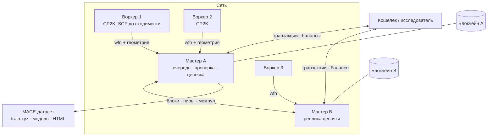
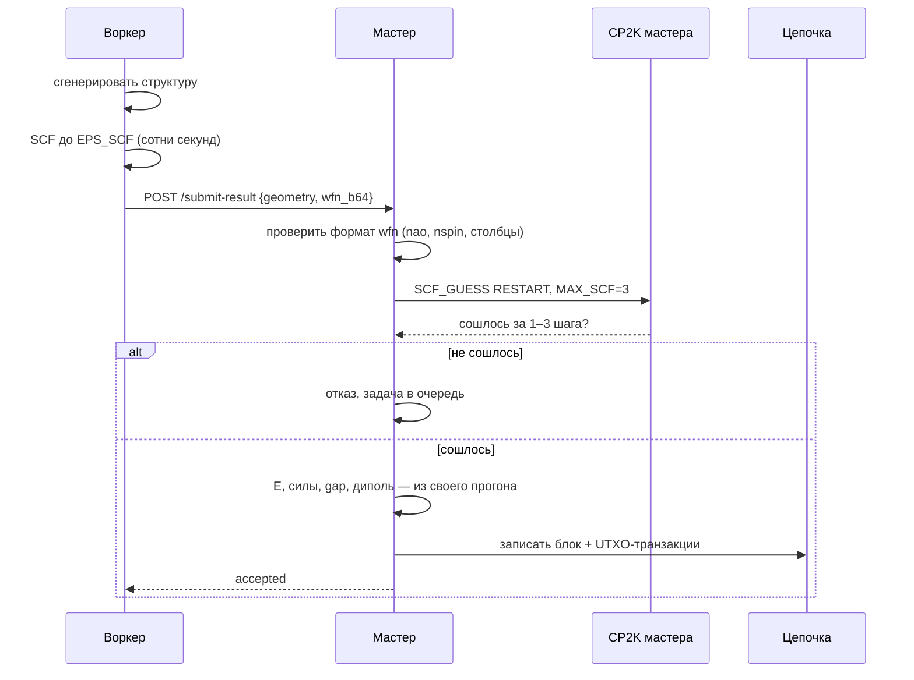
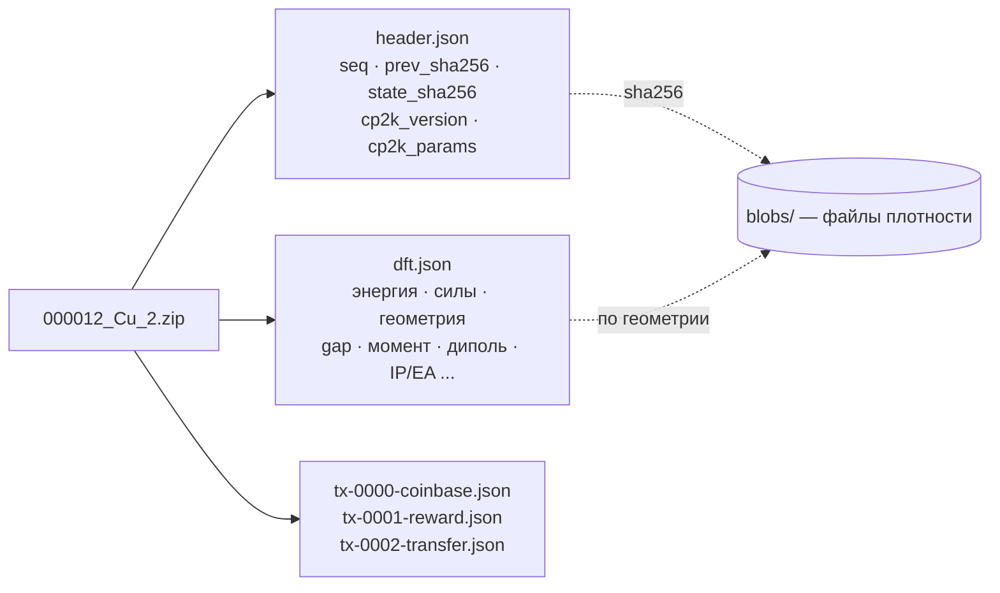
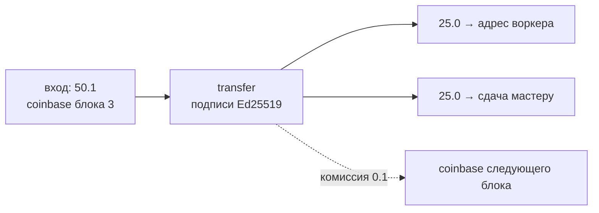
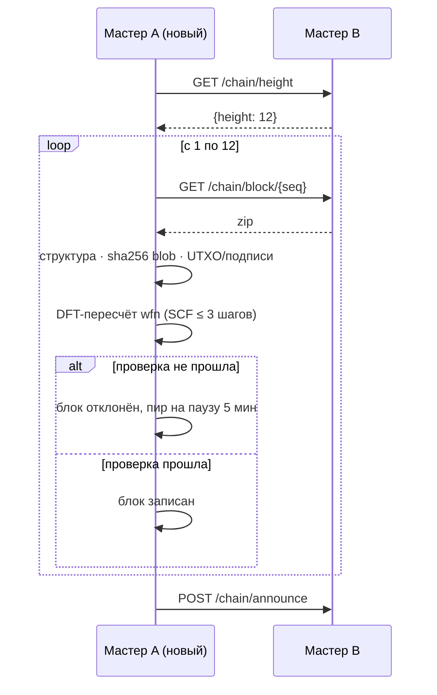

# Whitepaper: сеть распределённых DFT-расчётов

**Версия:** 1.0 · **Код:** [cp2k-mace-project](https://github.com/konstantinkorzov/cp2k-mace-project)

> Назад: [README](../README.md) · [Измерения](MEASUREMENTS.md) · [Публикация](PUBLISHING.md)

---

## Аннотация

Сеть считает электронную структуру молекул и кластеров **произвольного состава**
(Cu, Al₂O₃, NaCl, …) в CP2K силами независимых участников. Задача сети — получить **проверяемые** данные: заказчик (или исследователь)
должен быть уверен, что числа получены честным расчётом, не доверяя при этом ни
исполнителю, ни его машине. Для этого используется схема «нулевого доверия»:
исполнитель присылает не результат, а **файл плотности**, а заказчик сам доводит
расчёт до сходимости и берёт все величины из своего прогона.

Принятые результаты складываются в **блокчейн-цепочку**: блок содержит геометрию,
физические наблюдаемые и ссылку на плотность; транзакции учитывают вклад участников
в UTXO-модели; мастера обмениваются блоками и проверяют друг друга.

---

## 1. Проблема

Классический распределённый расчёт («пришли мне энергию») ломается о простой вопрос:
**как проверить, что энергию действительно посчитали, а не выдумали?**

Проверить «на глаз» нельзя: ошибка в 0.01 эВ уже физически значима, а восстановить
по одному числу, как оно получено, невозможно. Пересчитывать всё у заказчика —
значит потерять смысл распределения. Нужна схема, где проверка дешевле расчёта,
но при этом опирается только на проверяемые данные.

---

## 2. Роли и топология



| Роль | Что делает | Чего не делает |
|---|---|---|
| **Мастер** | ведёт очередь, проверяет результаты, пишет блоки, хранит цепочку, принимает транзакции | не доверяет числам воркера |
| **Воркер** | генерирует структуру, считает SCF до сходимости, отдаёт плотность | не получает монеты за «свои» числа |
| **Кошелёк** | подписывает переводы, показывает баланс и мемпул | не хранит цепочку целиком |
| **MACE-пайплайн** | строит датасет из принятых блоков, обучает модель | не участвует в консенсусе |

---

## 3. Проверка результата (zero-trust)

### 3.1 Что присылает воркер

Не энергию, а **файл состояния** `-RESTART.wfn` — матрицу коэффициентов плотности
по спиновым каналам (плюс геометрию). Это ~9.5 КБ для Cu₂. Всё остальное — телеметрия.

### 3.2 Почему не хватает «матричной» проверки

Первая версия проверяла алгебраические соотношения между матрицами H, C и λ,
полученными от воркера и пересчитанными мастером. Оказалось, что правила
**проверяют только согласованность**: подлог вида «случайная симметричная H и её
собственные векторы» проходит с невязками порядка `1e-15`, то есть математически
безупречно и физически бессмысленно. От схемы отказались полностью.

### 3.3 Сертификат: сходимость SCF от чужой плотности

Единственный честный сертификат — **стационарность** присланной плотности для задачи
мастера. Мастер пишет свой вход CP2K (свой элемент, базис, псевдопотенциал, ячейка,
функционал, геометрия), стартует от присланной плотности и требует, чтобы SCF сошёлся
за `RESTART_VERIFY_SCF = 3` шага.



Мастер разрешает три шага, потому что CP2K останавливает SCF по своему критерию,
и печатная невязка у честного состояния может быть чуть выше `EPS_SCF`: на Cu₂
(d = 2.56 Å) наблюдалось `1.34e-6 → 1.14e-6 → 3.0e-7`. Случайная или чужая плотность
так не сходится — ей нужны десятки шагов.

### 3.4 Что сверяет пир

Каждый чужой блок мастер проверяет так же, плюс сравнивает числа с собственным
пересчётом:

| Величина | Допуск |
|---|---|
| энергия | ±0.02 эВ (`PEER_TOL_ENERGY_EV`) |
| HOMO–LUMO gap | ±0.01 эВ |
| магнитный момент | ±0.05 μB (`PEER_TOL_MAG_UB`) |
| диполь | ±0.01 Д |

Так ловится блок, у которого настоящая плотность, но подправленные числа в `dft.json`.

---

## 4. Блок

Блок — это zip-архив; плотность в него не кладётся, только ссылка на неё.



### 4.1 header.json

```json
{
  "version": 1, "seq": 12, "element": "Cu", "n_atoms": 2,
  "prev_sha256": "…", "created_at": "2026-11-25T06:48:37Z",
  "state_sha256": "…", "state_path": "blobs/…wfn",
  "cp2k_version": "2024.3", "cp2k_params": { "cutoff": 400, "…": "…" }
}
```

`prev_sha256` — хэш файла предыдущего блока; у первого — 64 нуля. Цепочки по элементам
независимы.

### 4.2 dft.json: физические наблюдаемые

Всё — из одного прогона мастера (дополнительных шагов SCF нет).

| Поле | Единица | Экспериментальный аналог |
|---|---|---|
| `energy_ev`, `forces_ev_ang` | эВ, эВ/Å | — |
| `homo_lumo_gap_ev` | эВ | оптические спектры |
| `homo_ev`, `lumo_ev`, `fermi_ev` | эВ | UPS/XPS |
| `ip_koopmans_ev`, `ea_koopmans_ev` | эВ | ионизация / сродство |
| `magnetic_moment`, `spins_mulliken[]` | μB | магнетометрия, нейтронография |
| `charges_mulliken[]` | e | сдвиги остова в XPS |
| `dipole_debye[]` | Д | СВЧ/ИК |
| `s2`, `abs_spin_density` | — | спиновое загрязнение |
| `energy_components_hartree` | Ha | проверка целостности лога |
| `force_max/rms_ev_ang` | эВ/Å | насколько структура не в минимуме |

Правило отбора: десятки-сотни байт, есть экспериментальный аналог, получается из того же
прогона. Кубы, сетки DOS и колебательные спектры в блок не пишутся: `wfn` — сертификат
SCF, из него всё это пересчитывается скриптом.

### 4.3 Дедупликация плотностей

Файл состояния хранится один раз в `blobs/<sha256>.wfn`. Два блока с одинаковой
плотностью (повтор того же расчёта) занимают место один раз.

### 4.4 Целостность

Ссылка на предыдущий блок связывает цепочку в цепь: изменить блок «задним числом»
нельзя, не пересчитав все последующие `prev_sha256`. Файл плотности проверяется по
`state_sha256` при каждом чтении.

---

## 5. Идентичность и адреса

- Ключи — **Ed25519** (реализация на stdlib, проверена вектором RFC 8032).
- Адрес участника = `sha256(public_key)` в hex (64 символа); он же `pubkey_hash`
  в протоколе воркера.
- Приватный ключ хранится **зашифрованным**: `scrypt(password, salt)` →
  ключ шифрования → encrypt-then-MAC. Открытого приватного ключа в базе нет.
- У каждого кошелька **своя соль**, поэтому одинаковый пароль у мастера и воркера
  даёт разные хэши, разные ключи шифрования и разные адреса.

| Роль | Пароль (веб-панель) | CLI |
|---|---|---|
| Мастер | `master` | `--password` / `MASTER_PASSWORD` |
| Воркер | `worker` | `--password` / `WORKER_PASSWORD` |

---

## 6. Экономика: UTXO

### 6.1 Транзакция



- Вход ссылается на конкретный выход `(txid, vout)`; подпись — ключом владельца.
- Сумма входов ≥ сумма выходов; разница — **комиссия**, она уходит майнеру.
- Транзакция считается валидной, если все входы существуют, не потрачены,
  подтверждены и подписи верны.

### 6.2 Награды

| Параметр | Значение | Смысл |
|---|---|---|
| `COINBASE_VALUE` | 50 | субсидия за блок + все комиссии блока |
| `REWARD_VALUE` | 25 | выплата воркеру за принятый результат |
| `TX_FEE` | 0.1 | комиссия перевода |
| `coinbase_confirmations` | 1 | через сколько блоков монеты доступны |

Награда выплачивается **только на адрес вида 64 hex** — иначе монеты ушли бы «в никуда».

### 6.3 Кошелёк

Пароль открывает кошельки своей роли: вкладка «Кошелёк 1» — `master`, «Кошелёк 2» —
`worker`. Показаны адреса, балансы (доступно / pending / всего) и транзакции
с числом подтверждений. По клику — входы, выходы, комиссия, блок и сырой JSON.
Неподтверждённые транзакции видны сразу с пометкой «мемпул», а заблокированные ими
монеты уходят из «доступно» в «pending».

---

## 7. Мемпул

Мемпул — очередь неподтверждённых транзакций мастера.

- **Живёт на диске**: `results/<element>/mempool.json`, восстанавливается при старте.
- **Приём**: `POST /tx/submit` проверяет подписи, UTXO и подтверждения.
- **Конфликты**: новая транзакция вытесняет старые, тратящие те же входы.
- **Чистка**: как только появляется блок (свой или из сети), транзакции, чьи входы
  оказались потрачены, удаляются (`_prune_mempool`).
- **Кошелёк не тратит** выходы, занятые неподтверждёнными транзакциями, — повторная
  отправка не «съедает» предыдущую.

---

## 8. Сеть мастеров

### 8.1 Пиры и обмен адресами

Мастер раз в 2 минуты спрашивает у каждого пира `/admin/peers` и добавляет неизвестные
адреса себе (`MAX_PEERS = 64`). Воркер раз в минуту делает то же у своих мастеров —
так у него появляются резервные адреса. Панель (и кошелёк) при обновлении сети тоже
сообщает мастерам по одному неизвестному адресу.

### 8.2 Догон и проверка чужих блоков



### 8.3 Форки и самая длинная ветка

Перед майнингом мастер вызывает `catch_up_chain()`: опрашивает пиров, догоняет самого
высокого (с проверкой каждого блока), повторяет, пока никто не опережает. При равной
высоте остаётся на своей ветке. При форке ищет общего предка, откатывает свои блоки
в `orphan/<ts>/`, возвращает их транзакции в мемпул и переключается на ветку пира.

### 8.4 BUSY

Пока мастер догоняет сеть, он отвечает `{"status": "busy"}` на `/get-task`
и `/submit-result`. Задача при этом **остаётся за воркером** до `TASK_TIMEOUT` (час),
а готовый результат воркер несёт другому мастеру.

---

## 9. Кошелёк как сетевой клиент

Кошелёк не хранит цепочку: он опрашивает известных мастеров.

- раз в 5 секунд — баланс, подтверждения, мемпул;
- собирает мемпулы всех мастеров и показывает транзакции по своим адресам;
- перевод отправляет **всем** известным мастерам (какой примет — тот и запишет);
- список мастеров берётся из панели, из обнаруженных в сети и из пиров.

---

## 10. Модель безопасности

**Защищено:**

- подделка результата (нужен SCF из чужой плотности);
- подмена чисел в `dft.json` (пир пересчитывает и сверяет);
- изменение истории блоков (ломает `prev_sha256`);
- подделка транзакции (подписи Ed25519 по входам);
- воровство ключей из базы (приватные ключи зашифрованы).

**Не защищено (осознанные ограничения):**

| Риск | Статус |
|---|---|
| Sybil: новый ключ = новый воркер | не решается, награда мала |
| Перезапись всей цепочки владельцем всех мастеров | нужен внешний якорь (см. дорожную карту) |
| Админ-API без токена по умолчанию | для продакшена — `MASTER_ADMIN_TOKEN` + loopback |
| Слабый пароль (`root`) | менять перед реальной работой |
| Reorg дорог: каждый чужой блок — DFT-пересчёт | ~1–2 мин на блок |

---

## 11. Дорожная карта

1. **Внешний якорь**: публиковать `sha256` головы (git-коммит, OpenTimestamps).
2. **Подпись блока мастером** + хэш кода — блок проверяется без доверия к узлу.
3. **Merkle-root датасета** — одна подпись подтверждает все кадры.
4. **SPV-клиент**: заголовки + Merkle-proof транзакций.
5. **Гибкие комиссии** (сейчас `TX_FEE` — константа).
6. **Защита от zip-бомб** при чтении блоков.
7. **AES-GCM** вместо поточного шифра на stdlib.

---

## 12. Глоссарий

| Термин | Значение |
|---|---|
| **wfn / состояние** | CP2K `-RESTART.wfn`: матрица коэффициентов плотности |
| **приёмка** | прогон мастера от чужой плотности с требованием сходимости за 3 шага |
| **блок** | zip: `header.json` + `dft.json` + транзакции |
| **blob** | файл плотности в `blobs/<sha256>.wfn` |
| **UTXO** | непотраченный выход транзакции |
| **coinbase** | транзакция-субсидия, создающая монеты блока |
| **мемпул** | очередь неподтверждённых транзакций |
| **reorg** | переключение на более длинную ветку с откатом своих блоков |
| **этап** | размер кластера, на который сейчас идёт сбор данных |

---

## Приложение A. Сколько блоков нужно на размер

Задача: решить, какой размер кластера считать и сколько структур на него собрать.

### A.1. Почему нельзя «поровну на каждый размер»

Число локальных минимумов кластера растёт примерно **экспоненциально** по n
(для леннард-джонсовских кластеров в литературе — порядка 1.5–2× на атом
в диапазоне n ≤ 13). Полный перебор минимумов невозможен уже при n ≈ 20.
С другой стороны, покрытие всего конфигурационного пространства требует
`ε^-(3n-6)` точек — тоже экспонента. Значит, любая практическая схема
**недостаточна**, и вопрос только в том, где поставить компромисс.

### A.2. Модель

Пусть этап `s` соответствует размеру `n = start + (s−1)·u` (`u` — размер формулы),
а число блоков на этапе

```
B(s) = base · s^p ,        C(s) = Σ_{k=1..s} B(k)
```

Тогда этап s занимает высоты `[C(s−1), C(s))`.

| p | B(2)…B(6) | C при n=10 | смысл |
|---|---|---|---|
| 1 | 10, 20, 30, 40, 50 | 450 | линейно по размеру — недооценивает рост числа изомеров |
| **1.5** | **10, 28, 52, 80, 112** | **1110** | компромисс: рост заметно быстрее линейного, но не взрывной |
| 2 | 10, 40, 90, 160, 250 | 2850 | квадратично: примерно число парных окружений (n²/2) |

Почему `p ≈ 1.5`:

1. **Нижняя граница (p = 1).** Каждая структура размера n даёт ~n локальных
   окружений; чтобы у модели был хотя бы один пример на «тип атома», хватает
   линейного роста. Но он не покрывает разнообразие изомеров.
2. **Верхняя граница (p = 2).** Число парных расстояний в кластере ~n²/2 —
   естественная размерность признакового пространства парного потенциала.
   Равномерное покрытие этого пространства требует O(n²) структур, но
   message-passing-модель извлекает больше из одной структуры, поэтому
   квадрат — уже избыточен.
3. **Геометрическое среднее.** p = 1.5 даёт `~n·√n` структур на размер и
   суммарно `~n^2.5` блоков — тот же порядок, что и объём «оболочки» вокруг
   равновесия в 3-мерном пространстве, умноженный на число сортов атомов.

### A.3. Где живёт расписание

`start_atoms`, `base_blocks`, `exponent` и `max_atoms` — **константы протокола**
(`ATOM_SCHEDULE` в `src/main.py`), а не настройки мастера. Причина простая: от них
зависит, какой размер кластера считается на данной высоте. Если два мастера
зададут их по-разному, на одной высоте появятся блоки разных размеров, и
цепочки разойдутся без всякого злого умысла. Смена правила = новая версия
протокола и новая сеть (новый генезис).

Так же в коде зафиксировано чередование размерностей: `DIM_CYCLE = (3, 2)` —
ровно половина заданий объёмные, половина плоские. Это тоже часть консенсуса:
иначе воркеры начинали бы генерировать разные распределения структур.

### A.4. Ограничения

- `max_atoms = 0` — потолка нет, размер растёт с высотой без ограничений.
- Для больших систем (десятки–сотни атомов) узкое место — не число блоков,
  а **генерация структур**: случайная укладка почти не попадает в низкоэнергетические
  бассейны. Нужны basin hopping / генетические алгоритмы / активное обучение —
  это следующий шаг, а не настройка.
- Случайная генерация **не найдёт фуллерен**: C₆₀ — конкретная клетка, а не
  типичная конфигурация случайного облака атомов. Плоские и объёмные структуры
  дают разнообразие для обучения, но целевые мотивы (клетки, кольца) требуют
  стартовых шаблонов или специализированного генератора.
- Для белков и других систем в тысячи атомов кластерный режим неприменим
  физически: нужны фрагментация (QM/MM, фрагментные методы) или произвольный
  вход CP2K, который мастер будет раздавать как шаблон. Сейчас поддерживается
  **любой состав** (Al₂O₃, NaCl, …), но геометрия всё ещё генерируется случайно,
  а не задаётся экспертом.

