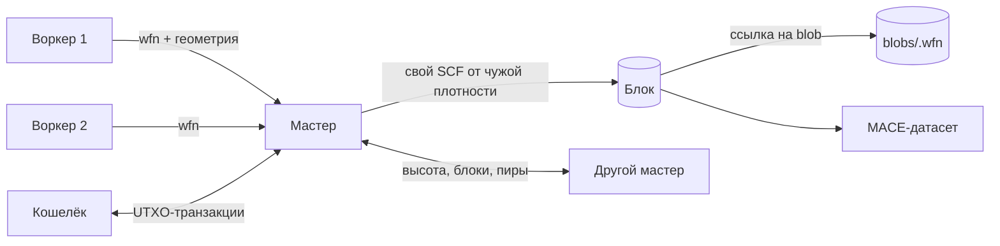
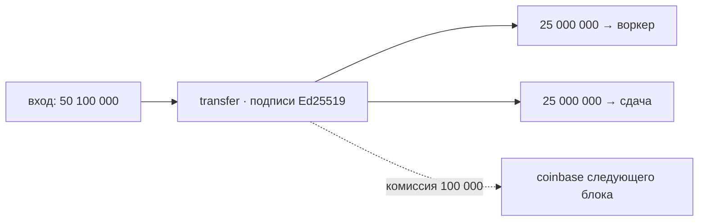

# CP2K–MACE: сеть проверяемых DFT-расчётов

**Whitepaper · протокол v7 · ноябрь 2026**

> [README](../README.md) · [Аудит](AUDIT.md) · [Измерения](MEASUREMENTS.md) · [Публикация](PUBLISHING.md)

---

## Аннотация

Сеть выполняет расчёты электронной структуры молекул и кластеров произвольного
состава (Cu, Al₂O₃, NaCl, …) в CP2K силами независимых участников и складывает
принятые результаты в цепочку блоков с UTXO-экономикой. Задача — получать
**проверяемые** данные, не доверяя ни исполнителю, ни его машине.

Проверка построена на файле состояния: воркер присылает `-RESTART.wfn`, мастер
сам доводит SCF до сходимости и берёт энергию, силы и наблюдаемые только из
своего прогона. Цепочка устроена так, что содержимое каждого блока входит во
**вход** расчёта следующего: переписать K блоков можно только за K новых
DFT-прогонов. Работа не тратится на хэши — она же и есть датасет.

---

## 1. Введение

Распределённый расчёт упирается в вопрос проверки: как убедиться, что энергию
посчитали, а не выдумали? Пересчитать всё у заказчика — потерять смысл
распределения; доверять числу — отказаться от гарантий.

Протокол решает это в два слоя:

1. **Сертификат работы.** Воркер возвращает не число, а состояние (плотность);
   мастер завершает расчёт от него. Подделка состояния либо не сходится, либо
   даёт числа, которые мастер всё равно не использует.
2. **Привязка истории.** Блок определяется каноническим хэшем, включающим
   корень транзакций, хэш плотности и хэш результатов. Геометрия следующего
   блока выводится из этого хэша, поэтому правка истории требует повторного
   расчёта.

В отличие от proof-of-work, дорогая работа здесь полезна: каждый блок — это
кадр (геометрия + энергия + силы + наблюдаемые) для обучения MACE.

---

## 2. Модель угроз и цели

**Противники.** Воркер (не хочет считать), мастер-пир (хочет подделать историю
или занять ресурсы), внешний клиент (флуд, обход авторизации). Сеть
permissionless: любой может подключиться.

**Допущения.** Все узлы используют сборку CP2K, зафиксированную протоколом
(образ и digest); метод (функционал, базис, псевдопотенциалы, ячейка)
определён константами. Честные участники контролируют большую часть
вычислительной мощности — иначе 51%-атака возможна, как в любой
proof-of-work системе.

**Цели.** Проверяемость результата; невозможность дешёвой перезаписи истории;
целые деньги без плавающей точки; устойчивость к флуду; воспроизводимость
датасета.

**Вне области.** Приватность транзакций и структур; мгновенная финальность;
защита от оператора собственного узла.

---

## 3. Обзор системы



| Роль | Обязанности | Не делает |
|---|---|---|
| **Мастер** | очередь, генерация геометрии, приёмка, запись блоков, ретрансляция | не доверяет числам и геометрии воркера |
| **Воркер** | считает выданную структуру до сходимости SCF | не генерирует и не меняет геометрию |
| **Кошелёк** | подписывает переводы, показывает баланс | не хранит цепочку целиком |

Жизненный цикл задания: мастер выбирает размер по расписанию высоты и строит
геометрию → воркер считает DFT → мастер проверяет состояние и геометрию →
блок записывается, транзакции обновляют UTXO. Воркер получает вознаграждение
за принятый результат.

---

## 4. Сертификат работы

### 4.1 Файл состояния вместо числа

Воркер возвращает `-RESTART.wfn` — коэффициенты разложения плотности по
спиновым каналам. Мастер пишет собственный вход CP2K (свой базис,
псевдопотенциалы, ячейка, функционал) и запускает SCF **от присланной
плотности**. Принимается только состояние, сходящееся за
`RESTART_VERIFY_SCF = 3` шага: это означает, что плотность стационарна для
задачи мастера. Случайная или чужая плотность требует десятков шагов.

Энергия, силы, HOMO–LUMO, магнитный момент, диполь и заряды берутся из прогона
мастера; числа воркера — телеметрия и на результат не влияют.

### 4.2 Геометрия

Геометрию строит мастер из `seed = H(prev_id ‖ nonce)` и параметров системы
(состав, диаметр), воркер её не выбирает: никаких шаблонов и внешних структур.
Присланная геометрия сверяется с выданной до DFT; дополнительно действует
физический минимум `0.5 Å` между атомами.

`atom_diameter` — консенсусное поле заголовка (протокол v7): строка **ровно с
тремя знаками** после точки (`"2.560"`), один диаметр на цепочку, минимум
`0.5 Å` (`MIN_DIAMETER_ANG`). Число в JSON не хранит хвостовой ноль, поэтому
2.56 и 2.560 давали бы разные `block_id`; строка это исключает. Лишние знаки
отбрасываются при записи (усечение, не округление), блок с чужим диаметром —
чужой блок.

---

## 5. Цепочка и привязка истории

### 5.1 Блок v7

```
tx_root   = Merkle(txids)                       # листья H(0x00‖txid), узлы H(0x01‖L‖R)
block_id  = H(prev_id ‖ seq ‖ tx_root ‖ state_sha256 ‖ dft_sha256 ‖ header_commit)
prev_id   = block_id предыдущего блока
```

`header_commit` включает элемент, размер, размерность, `atom_diameter`,
`geom_version`, отпечаток сборки CP2K и параметры метода. Файл плотности в блок
не кладётся: он хранится один раз в `blobs/<sha256>.wfn` (content-addressed
хранилище), в заголовке — только ссылка и хэш.

### 5.2 Seed и правило воспроизведения

```
seed(N)     = H(prev_id(N-1) ‖ nonce)
geometry(N) = Generate(seed, n, dim, atom_diameter, composition, geom_version)
```

Пир, проверяющий блок N, регенерирует геометрию из `prev_id` и `nonce` и требует
совпадения с `dft.json` (допуск 1e-6 Å). `nonce` — обычное 64-битное число, не
proof-of-work: он позволяет разным воркерам считать разные структуры на одной
высоте.

### 5.3 Стоимость перезаписи

Пусть блок N изменён (убрана транзакция, подменены числа). Тогда:

1. меняется `tx_root` или `dft_sha256` → меняется `block_id(N)`;
2. у блока N+1 меняется `prev_id` → меняется `seed(N+1)`;
3. геометрия N+1 обязана измениться, старый `wfn` для неё невалиден → нужен
   новый DFT;
4. далее по индукции — для всех последующих блоков.

**Следствие.** Переписать K блоков стоит K прогонов DFT — столько же, сколько
стоит их создать. Подпись мастера этого не меняет: ключ подписывает новый
`block_id` так же, как старый.

Самый свежий блок защищён работой только следующего (0 подтверждений) — это
стандартная модель подтверждений; стоимость перезаписи растёт с глубиной.

### 5.4 Формат заголовка

19 полей с фиксированными типами; лишнее или отсутствующее поле делает блок
невалидным.

| Поле | Назначение |
|---|---|
| `version`, `seq`, `system`, `composition`, `dim`, `n_atoms`, `atom_diameter` | параметры блока и генерации |
| `prev_id`, `block_id` | связь и идентичность |
| `tx_root`, `dft_sha256`, `state_sha256` | обязательства на транзакции, результаты, плотность |
| `nonce`, `geom_version` | воспроизводимость геометрии |
| `cp2k_version`, `cp2k_build`, `cp2k_params` | метод и сборка |
| `created_at`, `state_path` | время и ссылка на blob |

---

## 6. Реестр

### 6.1 UTXO и целые единицы

Деньги — только целые числа: дробная арифметика в консенсусе даёт расхождения
и обходит проверки. Эмиссия за блок — 50 000 000 единиц, вознаграждение
воркеру — 25 000 000, комиссия по умолчанию — 100 000.



Валидность транзакции: входы существуют и не потрачены, подписи соответствуют
адресам, каждая сумма — целое положительное число, сумма входов не меньше
суммы выходов. Разница — комиссия майнера. Coinbase не может превысить
субсидию плюс комиссии блока; его выходы созревают через
`COINBASE_MATURITY` блоков.

### 6.2 Мемпул

Политика в духе Bitcoin:

- лимит `MEMPOOL_MAX_TX = 10 000`; при заполнении вытесняется транзакция с
  наименьшей комиссией;
- конфликт (тот же вход) заменяется только транзакцией с большей комиссией;
- в блок попадает до `MAX_TXS_PER_BLOCK = 2000` переводов по убыванию
  комиссии; остальные ждут следующего блока;
- мемпул персистентен, запись на диск — с дебаунсом.

---

## 7. Приёмка

Проверки идут от дешёвых к дорогим:

1. схема заголовка, пересчёт `block_id`, `prev_id`, `tx_root`, `dft_sha256`;
2. регенерация геометрии из `seed(prev_id, nonce)` и сверка с блоком;
3. транзакции: UTXO, подписи, комиссии, зрелость, лимит переводов;
4. blob: `sha256` файла состояния;
5. DFT: чтение заголовка `wfn`, запуск SCF от него, сверка энергии и
   наблюдаемых с `dft.json`.

Пир проверяет чужой блок так же, включая полный пересчёт DFT. Толерансы
сверки: энергия 0.02 эВ, gap 0.01 эВ, магнитный момент 0.05 μB, диполь 0.01 Д.

---

## 8. Сеть

- **Gossip.** Мастера обмениваются адресами и головами цепочек; воркеры
  узнают мастеров у мастеров. Регистрация воркера подтверждается подписью
  одноразового nonce — иначе чужой адрес можно было бы «занять» и снимать
  задачи.
- **Догон и реорг.** Выбирается более длинная валидная ветка; при переключении
  транзакции отброшенной ветки возвращаются в мемпул. Каждый блок ветки
  проходит полную проверку.
- **Blobs.** Плотности лежат в локальном content-addressed хранилище и
  скачиваются у пиров по хэшу; мусор от непринятых блоков удаляется.
- **Сборка CP2K.** Базовый образ закреплён по digest, отпечаток сборки пишется
  в заголовок; мастер с опознанной чужой сборкой не стартует.
- **Чекпоинты (в развитии).** Периодический `(height, block_id)`,
  подписанный кворумом мастеров или заякоренный во внешнем timestamp, даёт
  финальность старым блокам и позволяет новому узлу проверять только хвост,
  а не всю цепочку.

---

## 9. Безопасность

| Атака | Механизм защиты | Остаточный риск |
|---|---|---|
| Выдуманные числа | энергия и наблюдаемые берутся из прогона мастера | — |
| Чужой или случайный wfn | SCF за 3 шага от состояния | — |
| Подмена геометрии | мастер выдаёт геометрию, сверка в шаблонном режиме, физический минимум | random-режим не обещает распределение |
| Перезапись истории | `seed(prev_id)`: K блоков = K DFT | 51 % мощности |
| Эмиссия через суммы | целые числа, положительные выходы, coinbase ≤ субсидия + комиссии | — |
| Двойная трата | UTXO и подписи Ed25519 | — |
| Чужая личность воркера | proof-of-key (nonce + подпись) | — |
| Флуд | rate limit выдачи и приёма, лимит тела, мемпул по комиссии | распределённый флуд |
| Мусорные блоки от пира | полная проверка, лимиты, карантин (план) | CPU-расход на проверку |
| Рассинхрон генератора | `geom_version` в заголовке | обновление = новая версия протокола |

Ключи Ed25519 хранятся зашифрованными (scrypt + encrypt-then-MAC); подпись
транзакции вычисляется по `txid`, не включающему подписи, поэтому подмена
выхода после подписи невозможна.

---

## 10. Экономика

Эмиссия фиксирована за блок и не зависит от сложности. Воркер получает
вознаграждение за принятый результат, мастер — субсидию и комиссии. Стоимость
атаки на историю пропорциональна числу переписываемых блоков и равна стоимости
их честного производства; внешней траты энергии нет — работа становится
датасетом. Ценность сети растёт с качеством и объёмом данных, а не с хешрейтом.

---

## 11. Ограничения и развитие

- **Синхронизация длинной цепи.** Полная проверка требует DFT на каждый блок.
  Решение — чекпоинты и доверенный снапшот с кворумом подписей.
- **Финальность.** Сейчас вероятностная (глубина подтверждений). Кворумные
  чекпоинты дадут детерминированную.
- **Шаблоны.** Шаблон попадает в блок и участвует в консенсусе; разные шаблоны
  у разных мастеров — это разные выборки, а не форк.
- **Приватность** транзакций и структур не обеспечивается.
- **Масштаб.** Один расчёт на блок; рост N увеличивает стоимость блока
  суперлинейно.

---

## Приложение A. Расписание размеров

Этап `s` соответствует кластеру `n = start + (s−1)·формула`; число блоков на
этап — `B(s) = base · s^1.5` (`base = 10`, `exponent = 1.5`). Рост быстрее
линейного отражает рост числа локальных минимумов с размером системы.

| Система | Этап для n | Блоков на этап | Всего блоков до n |
|---|---|---|---|
| Cu, n = 55 | 54 | 3 968 | 83 741 |
| Cu, n = 200 | 199 | 28 072 | 2 220 543 |
| Cu, n = 2000 (потолок) | 1999 | 893 756 | 715 094 595 |

Числа — точные суммы по дискретному расписанию (прежняя редакция давала 85 710
для n = 55: это интегральная оценка `∫10·s^1.5`, а не сумма).

`max_atoms = 2000` — потолок РАЗМЕРА кластера, а не числа блоков: после него
этапы продолжаются с n = 2000 и той же субсидией 50 000 000 за блок. Это
осознанное решение: эмиссия «за блок» не ограничивает общее предложение, и
переход к halving/остановке — отдельный форк протокола, а не текущее правило.

Размерности чередуются: `DIM_CYCLE = (3, 2)` — половина заданий объёмные,
половина плоские. Расписание и чередование — константы протокола, а не
настройки: разные значения у мастеров дают блоки разных размеров на одной
высоте.

---

## Приложение B. Константы протокола

| Константа | Значение |
|---|---|
| `BLOCK_VERSION` | 7 |
| `GEOM_VERSION` | 1 |
| `COINBASE_VALUE` / `REWARD_VALUE` | 50 000 000 / 25 000 000 |
| `DEFAULT_FEE` (политика кошелька, не консенсус) | 100 000 |
| `COINBASE_MATURITY` | 1 блок |
| `MAX_TXS_PER_BLOCK` / `MEMPOOL_MAX_TX` | 2 000 / 10 000 |
| `RESTART_VERIFY_SCF` | 3 шага |
| Допуск геометрии | 1e-6 Å |
| Сверка с пиром: E / gap / mag / диполь | 0.02 эВ / 0.01 эВ / 0.05 μB / 0.01 Д |
| `MIN_ATOM_DISTANCE_ANG` / `MIN_DIAMETER_ANG` | 0.5 Å |
| `DIAMETER_DECIMALS` | 3 (строка `"2.560"`, усечение) |
| `READY_QUOTA_PER_HOUR` / `TOTAL` / `PER_IP` (политика узла) | 12 / 60 / 24 |
